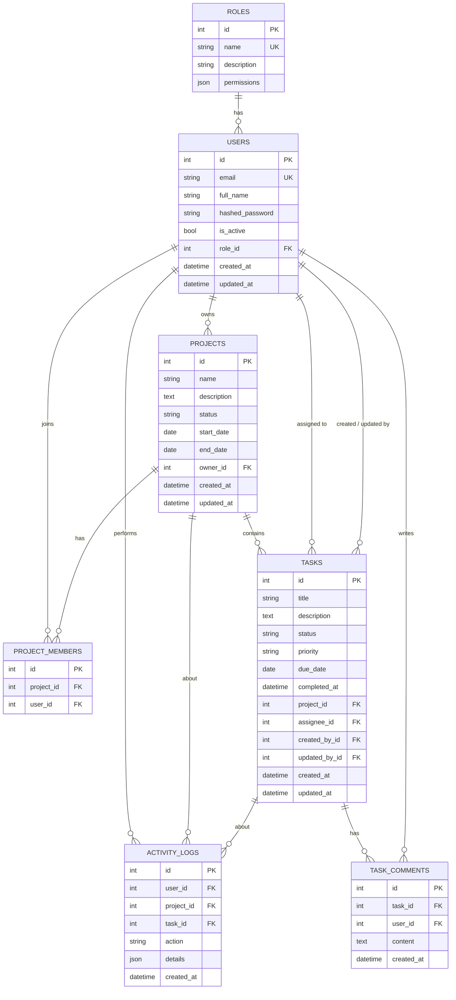

# Database Schema (ER Diagram)

Rendered automatically on GitHub (Mermaid).

## Relationship notes
- **Users ↔ Roles**: many-to-one. A role carries a JSON list of permissions, so Admin can change what a role may do.
- **Projects ↔ Users**: many-to-many through `project_members` (unique on `project_id + user_id`), plus a separate `owner_id`.
- **Tasks** belong to one project (`ON DELETE CASCADE`); `assignee_id`, `created_by_id`, `updated_by_id` use `ON DELETE SET NULL`.
- **Task comments** cascade-delete with the task.
- **Activity logs** use `SET NULL` on project/task, so the audit trail survives deletions.
- Indexes: `users.email`, task `status/priority/due_date/project_id/assignee_id`, activity `action/created_at`.
